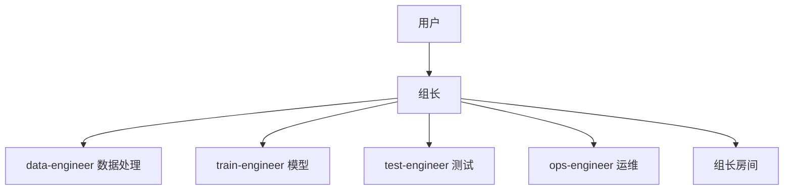
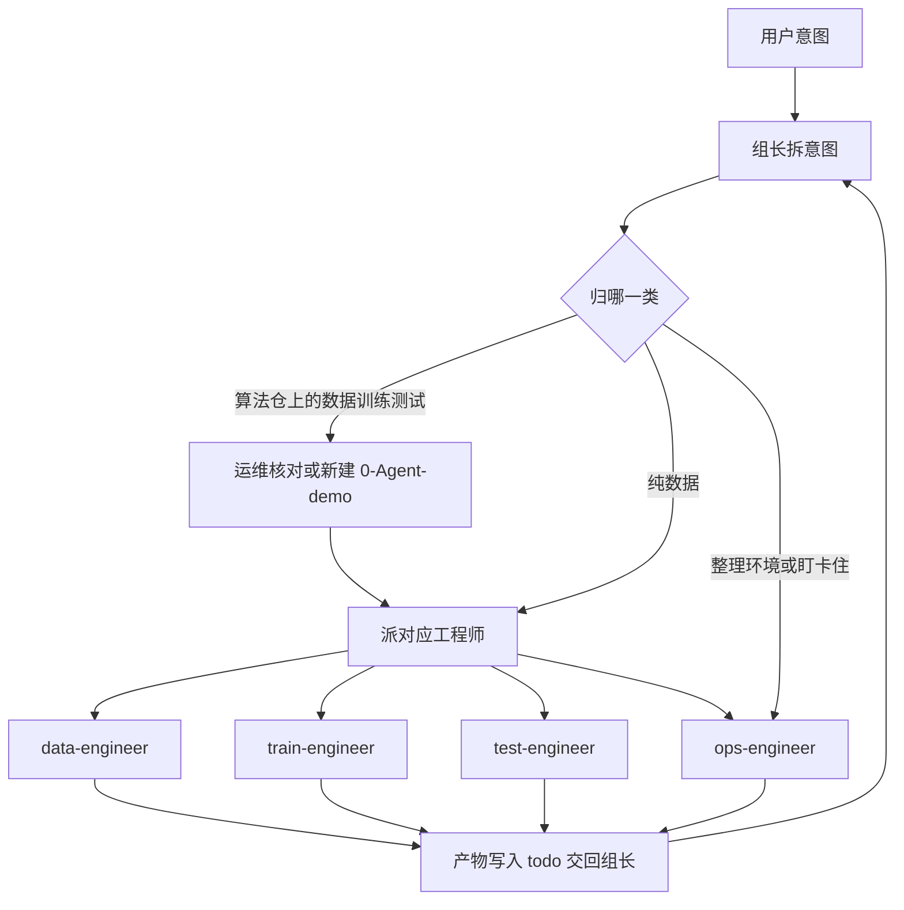
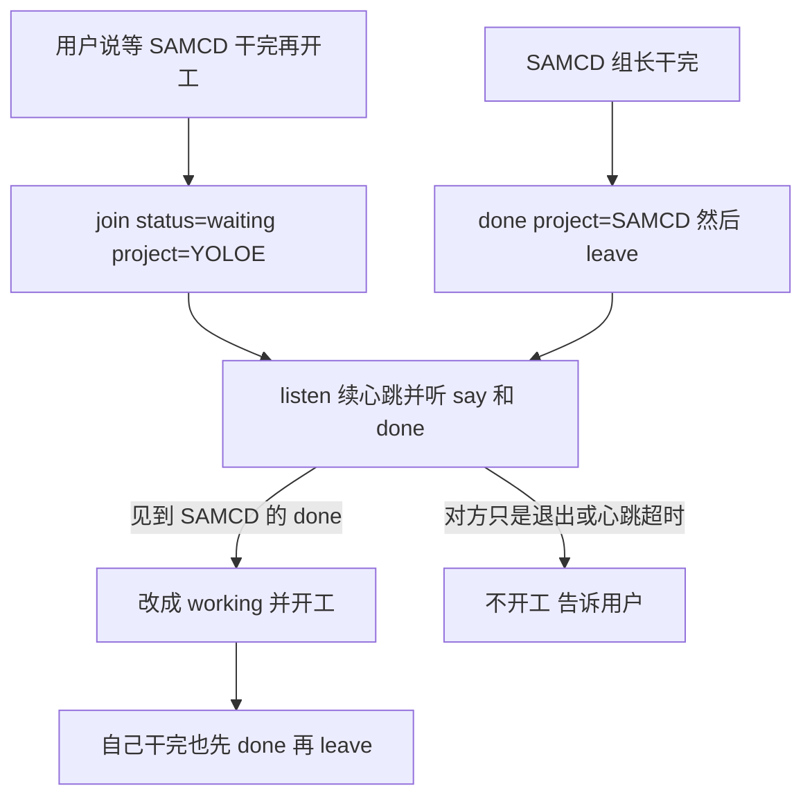

# 算法助手

标注和数据产线的 Cursor 工作区。你说话，组长派工，`skills/` 路由，`tools/` 执行。不绑某一台机器。Windows 不起 vLLM 和 SAM。

克隆后用 Cursor 打开本目录，对新对话说「请进行项目初始化」。地图可以是空的，路径由你当场给。

- **19** 个技能：调度 6、规范 8、工具 5
- **5** 个数据引擎已接线
- 本快照不含已有客户票。初始化之后在 `.cursor/customer/` 开票

- [怎么开始](#0-怎么开始)
- [仓库里有什么](#1-仓库里有什么)
- [团队架构](#2-团队架构)
- [一条请求怎么走](#3-一条请求怎么走)
- [组长房间](#4-组长房间)
- [四名工程师](#5-四名工程师)
- [技能分三层](#6-技能分三层)
- [数据引擎接线](#7-数据引擎接线)
- [识图四段](#8-识图四段)
- [客户票](#9-客户票)

---

## 0 怎么开始

1. 克隆本仓库，用 Cursor **打开这个目录**。技能在 `.cursor/skills/`，不要链到用户家目录，否则 `REPO` 会指错。
2. 新开一条 Agent 对话，说「请进行项目初始化」。其它对话不跑初始化。
3. 助手按 `workenv/require.md` 问数据根、项目根、文档路径，以及要不要连服务器。地图是空表时直接问这几项。已经写下具体路径时，只把那些路径念出来请你改口。确认前不扫盘，不沿用别的机器。
4. 要连服务器时先做密钥探测（`BatchMode`，不输密码）。`link.md` 确认列还是待确认的主机，不能当成已经点头。探测通过后再确认那台机器上的目录。
5. 看 `workenv/README.md` 并点头。点头之前，确认列不能改成已确认。点头之后，才把 `link.md` 里的 URL 写回 `.cursor/model/config/vllm_server.json` 和 `sam.json`。
6. 服务是否在跑，在 `.cursor` 下执行 `py -3 model/util/probe.py`。Windows 不起 vLLM / SAM。没起来的记在 `workenv/API-server.md`，想搭的时候再说。

客户票里的路径是各单自己的。没确认的项停下来问。

---

## 1 仓库里有什么

```
./
├── README.md                         # 本文件
├── workenv/                          # 工作地图。克隆下来是待确认
│   ├── require.md                    # 初始化脚本
│   ├── link.md                       # 主机、目录、启动脚本、URL
│   ├── API-server.md                 # 探活和自搭建说明
│   └── env-local/                    # 本机数据根、项目根、文档
└── .cursor/
    ├── rules/                        # 常驻规则
    ├── skills/                       # 何时唤起、怎么确认
    ├── agents/                       # 四名工程师；TeamLeader 是组长房间
    ├── tools/                        # 叶子脚本
    ├── model/                        # vLLM / SAM 客户端和地址
    └── customer/                     # 客户票。本快照不含，开票后才有
```

---

## 2 团队架构

每条 Agent 对话都是组长，不另建 lead。四名工程师在 `.cursor/agents/`，点名可以直接进。项目整理、装环境和盯卡住派运维。



| 角色 | 做什么 |
| --- | --- |
| 组长 | 拆用户意图，派工，确认一次需求，按轻重汇总答复。房间身份是这条对话 |
| 数据处理 | 整理、预标、识图、定档、补标、改标签。金字塔扩标内部那轮训也在这里 |
| 模型 | 训练、验证、推理。工作区由运维核对或建好后再派来 |
| 测试 | 测试报告、误检漏检分析 |
| 运维 | 项目整理、装环境、未归类杂活。盯工程师无回音、对方心跳超时、资源被占 |
| 组长房间 | 各项目组长登记在岗、互相等活。不是工程师 |

工程师不互相派工。缺环境、要换工种或碰到杂活，写入票或槽的 `todo.md`，交回组长。缺环境由组长派运维装好再派回。

---

## 3 一条请求怎么走

数据、模型、测试、运维都派对应工程师，单模块也派。没有算法仓的纯数据活跳过 `0-Agent-demo`，`data_root` 仍须用户给。服务器协同先看 `workenv/link.md`。git 推远程要你开口才做。目标已经确认后，障碍由组长派工消化；卡住、心跳超时和资源被占派运维先查组长房间。对用户先单独一句结论，再按轻重分块分点，最后收一句已经想好的下一步。口吻像跟同事说。坏图坏标签移到缓存目录，不直接删。



| 步 | 落点 | 做什么 |
| --- | --- | --- |
| 1 听意图 | 组长 | 归成数据、模型、测试、运维 |
| 2 进场 | 运维，算法仓 `0-Agent-demo` | 有则按标准确认，无则新建，不开训。读仓库 README 和 `SKILL.md`，没核实的交回组长 |
| 3 确认 | 票 `require/` 或用户原话 | `data_root` 必须人给。已确认的项写进派工，不重复追问 |
| 4 派工 | 四名工程师 | prompt 写清路径、票或槽、交付物、工作区已齐或已构建。盯运转还要写组长 AgentID。子代理看不到主对话 |
| 5 叶子 | `tools/` | 分类和 GroundingPI 先探服务。sample 给人看，再全量。预标写 `draft/` 或 `jsons-pre` |
| 6 交回 | 票或槽 `todo.md` | 数据交产物路径，模型交权重，测试交报告和下一棒建议，运维交卡在哪一侧 |

---

## 4 组长房间

不同项目的组长互相等活，也互相留言。留言写在房间文件里。对方那条对话要已经挂着 `listen`，才会被叫醒去读。没挂上，留言就躺着，直到那边自己来读。



- 接到活才登记。纯问答不进房间。AgentID 用开场注入的那一个，没注入就先不登记。
- 只有本次等待开始之后的 `done` 才开工。关掉对话、心跳超过 45 分钟、或退出时没有 `done`，等待方不开工并告诉用户。
- 对方还没进房间也可以等。单次 `listen` 约 2 小时。安静结束就再挂一次。已经报过的那次退出不会再次挡下这次等待。
- 自己干完先 `done` 再 `leave`。活没干完只 `leave`。同一服务器、GPU 或数据根已有人在干活，先在房间里说一声。长活期间由运维挂 `listen`，用这条对话的 AgentID。

```bash
py -3 .cursor/agents/TeamLeader/room.py join --id <AgentID> --project YOLOE --status waiting --wait-for SAMCD --task "开训"
py -3 .cursor/agents/TeamLeader/room.py listen --id <AgentID>
py -3 .cursor/agents/TeamLeader/room.py done --id <AgentID> --project SAMCD
py -3 .cursor/agents/TeamLeader/room.py leave --id <AgentID>
```

脚本在 `.cursor/agents/TeamLeader/room.py`。在岗名单和留言是运行时文件。

---

## 5 四名工程师

数据、模型、测试、运维含单模块都由组长派。点名 `/data-engineer`、`/train-engineer`、`/test-engineer`、`/ops-engineer` 直接进该工程师。子代理看不到主对话，交接靠文件。

| 工程师 | 点名 | 负责 | 交回组长 |
| --- | --- | --- | --- |
| 数据处理 | `/data-engineer` | 整理、预标、识图、叠图质检、裁框改类、金字塔扩标 | 票 todo、产物路径、类名、是否人审 |
| 模型 | `/train-engineer` | 算法仓三槽开训、验证、推理。派工写明源码适配时，按 `agent-source_adapt` 把上游一个功能切进指定仓库。日常三槽不改上游源码 | 槽路径、权重、配置、日志；源码适配交移植说明 |
| 测试 | `/test-engineer` | 测指定版本，写 testlog。误检漏检分析汇总定档 `wrong` 和已有漏检，写入 `draft/analysis/` | 报告路径、指标、误漏检清单、补数还是改配 |
| 运维 | `/ops-engineer` | 项目整理、装环境、杂活。盯工程师无回音、对方心跳超时、资源被占 | 卡在哪一侧、已齐或已构建、建议的下一棒 |

数据处理工程师不开正训，也不自己装环境。质检打在 `draft/`，正式 `jsons/`、`labels/` 留到整理再写；预标里去掉 `wrong` 发生在写 `jsons-det-pre` / `jsons-seg-pre` 时。模型工程师按派工里的「已齐 / 已构建」进槽，确认 `Customer.md` 再开跑，不把未人审预标当 GT，也不自己出测试报告。源码适配不进三槽，只切派工点名的那一个功能。测试工程师要事先拿到权重版本和数据集，缺了就停；不改正式 GT，也不自己开新训。建议下一棒是补数还是改配。运维不进房间。长活期间挂 `listen`，只用派工里的组长 AgentID。缺环境由组长派运维装好再派回。

---

## 6 技能分三层

| 层 | 数量 | 入口 |
| --- | --- | --- |
| 调度 | 6 | 数据引擎、开票、金字塔、识图、三槽训练、源码适配 |
| 规范 | 8 | README、脚本、skill、数据集合并、叶子闸门、项目合并、Agent-demo、QuickStart |
| 工具 | 5 | 改标签、装环境、推远程仓、弱标签、SSH |

文件夹用下划线，YAML `name` 用连字符，例如 `agent-smart_image` 对应 name `agent-smart-image`。

---

## 7 数据引擎接线

以 `skills/agent-data_engine` 的调度表为准。未接线的行停住，不用别的叶子顶替。GroundingPI 出框后默认再走 SmartImage 叠图校验。定档之后的漏检、补标和调整都在 SmartImage。

| 能力 | 后端 | 落点 | 调度 |
| --- | --- | --- | --- |
| 整理数据集 | — | `1-DataEngine/0-Data-Organize` | 已接线，可写 `labels/` |
| 图像分类 | Qwen | `1-Image-Classify/qwen` | 已接线，先探 vLLM |
| 检测 / 分割 | YOLO26 | `2-Image-DetSeg/yolo26` | 已接线，本地权重 |
| 检测 / 分割 | SAM3 | `2-Image-DetSeg/sam3` | 已接线，文本提示 |
| 检测 / 分割 | GroundingPI | `2-Image-DetSeg/groundingpi` | 已接线，预标默认 |
| 检测 / 分割 | Qwen 旧叶 | `2-Image-DetSeg/qwen` | 磁盘还在，调度不再调用 |
| 识图 / 漏检补标 / 调整 | Qwen + SAM | `0-General/0-SmartImage` | 走 `agent-smart-image`。检测分割的 adjust 用框中心。变化检测先确认提示词，再由 Qwen 报点加 Triton SAM |
| Grounding 数据集 | YOLOE / SAM3 / Qwen | `3-GD` / `4-GD` / `5-GD` | 占位，未接线 |

---

## 8 识图四段已经接上

定档、漏检、补标、调整都在 `0-SmartImage`。检测分割和变化检测共用这些脚本，取点和定位不一样。误检漏检汇总归测试工程师。默认只写 `draft/`，用户说落盘才进 `jsons/`。来源：`agent-smart_image` 与 `0-SmartImage` README，2026-11-11。

### 检测 / 分割

漏检的点来自 Qwen，调整的点来自 adjust 框的中心。从裁图往后是同一条链。

| 点从哪来 | 怎么取点 | 谁被涂灰 | 结果 |
| --- | --- | --- | --- |
| 漏检 | Qwen 报完全没罩住的中心。灰上的点丢掉 | 已有目标全部涂灰 | `draft/miss/` |
| 调整 | 定档 adjust 的框中心，不再问 Qwen | 要改的目标不涂，其余涂灰 | `draft/adjust/` |

| 点之后 | 做什么 | 落点 |
| --- | --- | --- |
| 裁图 | 邻近点合成一张。不在图像边上可放大到 1280 | `draft/miss/crop/` 或 `draft/adjust/crop/` |
| 确认 | 先问落掩膜还是落框 | — |
| 掩膜 | GroundingPI 定位，Triton SAM 多边形就是结果 | `draft/fill/` 或 `draft/adjust/` |
| 框 | 同一条链再取掩膜的水平最小外接矩形。直出框要用户明确说 | 同上 |

调整时，新形状要罩住原来的中心才替换这一条。罩不住的不新加框。矩形涂灰前先交 Triton SAM，不把整框涂成方块。

### 变化检测

定档、漏检、补标、差检都接上了。漏检和差检开工前先确认要定位的变化，建筑和土地不写死。`--prompt` 为空就停。不走 GroundingPI，不覆盖原来的 png。

| 段 | 怎么做 | 结果 |
| --- | --- | --- |
| 定档 | `label_grade.py --masks`。每个连通域打 `fit` / `adjust` / `wrong`，`wrong` 是假变化 | `draft/overlay/` |
| 漏检 | 已有变化涂灰后左右拼接，Qwen 按确认过的句子报点。左图裁 T1 原图，右图裁 T2 | `draft/miss/` |
| 补标 | `opt_fill.py --shape mask --locate off --refine sam`。与原变化图重叠过大的丢掉 | `draft/fill/`，png 在 `draft/fill/masks/` |
| 差检 | `opt_adjust.py --masks`。Qwen 对 `adjust` 块重新报一个点，新掩膜必须罩住这个点 | `draft/adjust/`，png 在 `draft/adjust/masks/` |

误检漏检分析不在这条数据链上：测试工程师用 `analysis.py` 汇总，`wrong` 算误检，有 `draft/miss/` 才计漏检，写进 testlog 第 3 节。png 掩膜和目标框走同一个汇总脚本。

定档给出 `fit`、`adjust`、`wrong`。检测分割的漏检和 adjust 各自产生一个点，然后共用裁图、确认形状、GroundingPI 加 Triton SAM。掩膜直接落多边形，框取掩膜的水平最小外接矩形。Qwen 检测叶仍在磁盘上，调度不再调用。

---

## 9 客户票

本快照不含已有票。初始化完成之后，要开新票就说「客户任务」，助手按 `agent-customer_task` 在 `.cursor/customer/<kind>-<yymmdd>-<slug>/` 建 `.skill`、`require/`、`util/` 和 `todo.md`。进度只写该票 `todo.md`。票里的路径必须人给，不要猜。
