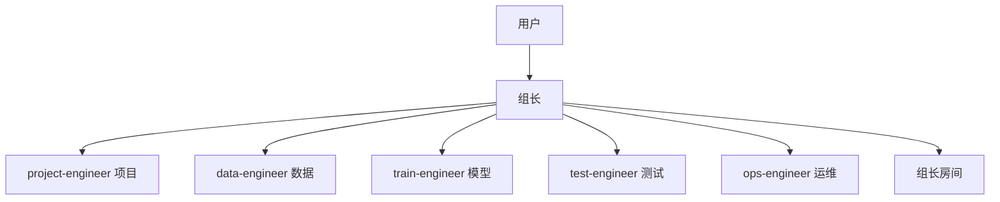
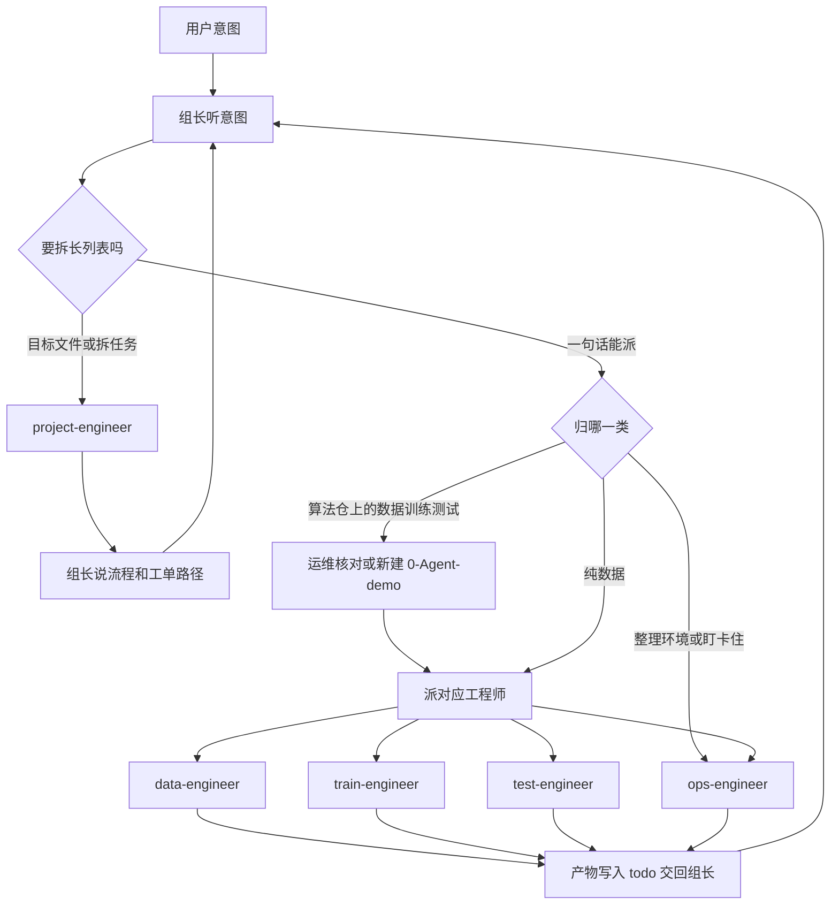
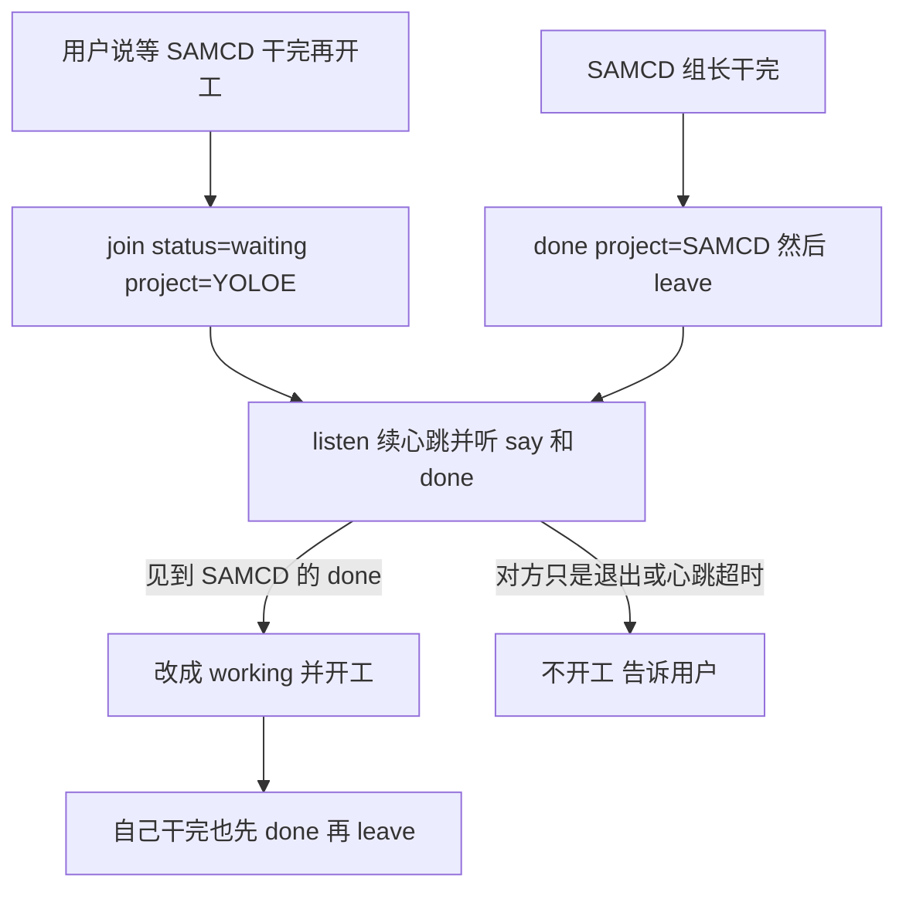

<div align="center">

# 🧭 视觉算法工程师助手

**依托 Cursor 的适配视觉算法工程师的 Agent 助手**

<p>
  
  
  
  
</p>


<p>
  <a href="#what">🧭 这是什么</a>　·　<a href="#start">🚀 怎么开始</a>　·　<a href="#layout">📁 仓库结构</a>　·　<a href="#team">👥 团队架构</a>　·　<a href="#flow">🔀 请求流程</a>
  <br>
  <a href="#room">💬 组长房间</a>　·　<a href="#engineers">👷 工程师</a>　·　<a href="#skills">📚 技能</a>　·　<a href="#engines">⚙️ 数据引擎</a>　·　<a href="#tickets">🎫 客户票</a>
</p>

</div>

---

<a id="what"></a>

## 🧭 这是什么

面向视觉算法工程师的 Agent 助手。依托工程师已有的训练框架和工作习惯，提供从项目管理、数据整理到模型实验的高效，无感知的全流程辅助。

- **团队协作。** 项目、数据、模型、测试和运维五位专业子 Agent 协同工作，实现从任务规划到结果交付的完整流程。
- **工作地图。** 记录项目、数据、服务器和服务的位置，让助手持续了解开发环境，减少重复配置与路径确认。
- **数据引擎。** 集成数据整理、自动标注、图像识别、标注质检、检测与分割等能力，打通视觉数据处理流程。
- **项目隔离。** 基于项目的工作，会建立独立工作区，拥有独立的数据、训练环境、配置和实验记录，过程可追溯。
- **任务隔离。** 基于独立任务的工作，如大型数据处理等临时任务，会单独开一张客户票，记下数据、步骤和进度，与项目工作区分开。
- **习惯学习。** 持续观察并积累用户的开发习惯与技术偏好，让助手逐渐理解你的工作方式，并在后续任务中主动适配。

目前只对 [Cursor](https://cursor.com) 生态友好。

其他 Agent 工具的使用者也可以先试着初始化试试看~

---

<a id="start"></a>

## 🚀 0 怎么开始

### 0.1 怎么唤醒它

用 Cursor **打开这个目录**，新开一条对话，说 **「请进行项目初始化」**

Agent 会询问你以下相关事项

| 问什么 | 举例 | 没给会怎样 |
| --- | --- | --- |
| **数据根** | 你的数据目录 | 数据活不开工。禁止猜盘 |
| **项目根** | 算法仓所在的根目录 | 只接纯数据活 |
| **文档路径** | 交付文档放哪 | 可以空着，先留占位 |
| **要不要连服务器** | 主机名或 IP | 只做本机活，训练推理往后放 |

地图是空表时一次问齐；已经写下具体路径时，它只念出来请你确认或改口。**你点头之前不扫盘，也不沿用别的机器。**

### 0.2 然后它会自己往下走

1. **写地图** —— 按你给的根展开 `workarea/env-local/`。数据按「到数据集」停，项目只到仓库一层。
2. **探服务器** —— 要连服务器时先做密钥探测，用 `BatchMode`，**不向你要密码**。`link.md` 的确认列还是「待确认」时，不把它当成你已经点头。
3. **请你过一眼** —— 把 `workarea/README.md` 摊开给你看，等你点头。点头之后，才把 `link.md` 里的启动脚本写进 `.cursor/server/ledger/runs.md`。
4. **探服务** —— 在 `.cursor` 下跑 `py -3 server/util/probe.py`，按条记进 `server/README.md` 与 `server/services/`。没起来的只登记、不擅自搭，**Windows 不起 vLLM / SAM**。服务固定是 Qwen / GroundingPI / Triton SAM 那几个，初始化只更新端口、API 和现状；装法在仓库根 `buildenv/0-VLM/`，初始化不动它。
5. **最后问两项** —— 要不要顺手整理某个算法仓、缺的服务现在搭不搭。**说「先不做」就跳过，跳过同样算完成。**

### 0.3 怎么算初始化好了

助手会说出这一句：

> 嗨！初次见面，我是你的算法助手！...

看到这句，就说明地图已经按你的确认落盘，服务地址也写进了 `.cursor/server/config/`。**服务没全部探通也算成功**，缺的记在 `server/ledger/runs.md`，不挡开工；以后想搭再喊一声。

### 0.4 初始化完能直接说什么

说了就派工，不用自己挑技能或脚本。

| 你说 | 会发生什么 | 产出落在 |
| --- | --- | --- |
| 「整理这个数据根」 | 数据处理工程师把已有标签整理成可训练布局 | `labels/`、`jsons/`、`train.txt` / `val.txt` |
| 「这批图先预标一下」 | 默认 GroundingPI 出框，**先出 sample 给你看**，点头后再全量 | `jsons-det-pre` / `jsons-seg-pre` |
| 「帮我看看这几张图的标注质量」 | 逐图打 `fit` / `adjust` / `wrong` 三档，附叠图 | `draft/` |
| 「这个算法仓开训」 | 运维先核对或新建 `0-Agent-demo` 三槽，再派模型工程师 | 槽里的权重、配置、日志 |
| 「测一下这个权重」 | 测试工程师出报告和误漏检清单，并建议下一棒补数还是改配 | `draft/analysis/` |
| 「按这个目标文件拆任务」 | 项目工程师对一下盘上已有的，再出工单。点头后才按步骤派 | `.cursor/customer/proj-<日期>-<名>/` |
| 「客户任务」 | 开一张客户票，之后的进度只写这张票 | `.cursor/customer/<票>/todo.md` |
| 「服务都通不通」 | 跑一遍探活，按条说明哪里不通、会影响哪块 | `.cursor/server/` |

---

<a id="layout"></a>

## 📁 1 仓库里有什么

```
./
├── README.md                         # 本文件
├── 开发日志.md                        # 每次迭代改了什么、为什么
├── buildenv/                         # 施工蓝图：每个算法仓、每种服务怎么从零搭起来
│   ├── README.md                     # 索引与写法
│   ├── 0-VLM/vllm.md                 # Qwen 与 GroundingPI 共用的 vLLM
│   └── ...
├── workarea/                         # 这台机器的工作地图。克隆下来是待确认
│   ├── link.md                       # 主机、目录、启动脚本、权重目录
│   ├── habits.md                     # 个人习惯画像：已确认的长期偏好
│   └── env-local/                    # 本机数据根、项目根、文档
└── .cursor/
    ├── rules/                        # 常驻规则
    ├── skills/                       # 何时唤起、怎么确认
    ├── agents/                       # 五名工程师；TeamLeader 是组长房间
    ├── tools/                        # 叶子脚本
    ├── server/                       # 服务端口、模型名、客户端、台账（装法在 buildenv）
    └── customer/                     # 客户票。本快照不含，开票后才有
```

---

<a id="team"></a>

## 👥 2 团队架构

每条 Agent 对话都是组长，不另建 lead。五名工程师在 `.cursor/agents/`，点名可以直接进。长列表先派项目工程师出工单；项目整理、装环境和盯这轮有没有卡点派运维。



| 角色 | 做什么 |
| --- | --- |
| 👤 组长 | 听意图，派工，按轻重汇总答复。长列表先派项目工程师。房间身份是这条对话 |
| 📋 项目 | 先对在岗落盘。工单要的目录已经在盘上就写成已齐，不问。再写可执行步骤 |
| 🗂️ 数据处理 | 整理、预标、识图、定档、补标、改标签。金字塔扩标内部那轮训也在这里 |
| 🏋️ 模型 | 训练、验证、推理。工作区由运维核对或建好后再派来 |
| 🧪 测试 | 测试报告、误检漏检分析 |
| 🛠️ 运维 | 项目整理、装环境、未归类杂活。盯这轮有没有卡点：进程没了、心跳超时没有 done、资源被占、服务口开了但业务没接上 |
| 💬 组长房间 | 各项目组长登记在岗、互相等活。不是工程师 |

工程师不互相派工。缺环境、要换工种或碰到杂活，写入票或槽的 `todo.md`，交回组长。缺环境由组长派运维装好再派回。

---

<a id="flow"></a>

## 🔀 3 一条请求怎么走

数据、模型、测试、运维都派对应工程师，单模块也派。用户给了目标文件或要拆任务，先派项目工程师开 `proj` 票，点头后再按步骤派。没有算法仓的纯数据活跳过 `0-Agent-demo`，`data_root` 仍须用户给。服务器协同先看 `workarea/link.md`。git 推远程要你开口才做。目标已经确认后，障碍由组长派工消化；这轮有没有卡点派运维先查组长房间，再看进程、端口和日志。对用户先单独一句结论，再按轻重分块分点，最后收一句已经想好的下一步。口吻像跟同事说。坏图坏标签移到缓存目录，不直接删。



| 步 | 落点 | 做什么 |
| --- | --- | --- |
| 1 听意图 | 组长 | 长列表先派项目工程师；单句活归成数据、模型、测试、运维 |
| 2 进场 | 运维，算法仓 `0-Agent-demo` | 有则按标准确认，无则新建，不开训。读仓库 README 和 `SKILL.md`，没核实的交回组长 |
| 3 确认 | 票 `require/` 或用户原话 | `data_root` 必须人给。已确认的项写进派工，不重复追问 |
| 4 派工 | 五名工程师 | prompt 写清路径、票或槽、交付物、工作区已齐或已构建。盯卡点还要写组长 AgentID，以及进程、端口或日志。子代理看不到主对话 |
| 5 叶子 | `tools/` | 分类和 GroundingPI 先探服务。sample 给人看，再全量。预标写 `draft/` 或 `jsons-pre` |
| 6 交回 | 票或槽 `todo.md` | 数据交产物路径，模型交权重，测试交报告和下一棒建议，运维交卡在哪一侧。没卡也要带 PID 或日志末行 |

---

<a id="room"></a>

## 💬 4 组长房间

每个项目一条对话，各自是组长。房间承担两件事：**串联**——上游 `done` 后，登记等待的下游才开工；**协调**——同一台服务器、GPU 或数据根已被占用时，先 `say` 协商再启动。留言写在房间文件里，对方那条对话需先挂着 `listen` 才会被唤醒读取；未挂上时留言保留在文件中，待对方读取。



- 接到活才登记，每轮先 `read`。纯问答不进房间。AgentID 用开场注入的那一个，没注入就先不登记。
- 只有本次等待开始之后的 `done` 才开工。关掉对话、心跳超过 45 分钟、或退出时没有 `done`，等待方不开工并告诉用户。
- 对方还没进房间也可以等。单次 `wait` 或 `listen` 约 2 小时。安静结束就再挂一次。长盯用 `watch`：安静打 `CHECK` 不退。已经报过的那次退出不会再次挡下这次等待。
- 自己干完先 `done` 再 `leave`。活没干完只 `leave`。同一服务器、GPU 或数据根已有人在干活，先在房间里说一声。长活期间这条对话自己挂 `watch`，运维另盯进程。运维子代理掉线立刻再派，不要等用户问。

脚本在 `.cursor/agents/TeamLeader/room.py`，在岗名单和留言是运行时文件。

---

<a id="engineers"></a>

## 👷 5 五名工程师

项目、数据、模型、测试、运维含单模块都由组长派。点名 `/project-engineer`、`/data-engineer`、`/train-engineer`、`/test-engineer`、`/ops-engineer` 直接进该工程师。子代理看不到主对话，交接靠文件。五名工程师不钉模型，跟随组长这条对话当前的模型，派工时也不要另指定模型。

| 工程师 | 点名 | 负责 | 交回组长 |
| --- | --- | --- | --- |
| 📋 项目 | `/project-engineer` | 先对在岗落盘。工单要的目录已在盘上就写成已齐，不问。再写可执行步骤 | 票路径、产物对照、请组长定、现在拍板 |
| 🗂️ 数据处理 | `/data-engineer` | 整理、预标、识图、叠图质检、裁框改类、金字塔扩标 | 票 todo、产物路径、类名、是否人审 |
| 🏋️ 模型 | `/train-engineer` | 算法仓三槽开训、验证、推理。派工写明源码适配时，按 `agent-source_adapt` 把上游一个功能切进指定仓库。日常三槽不改上游源码 | 槽路径、权重、配置、日志；源码适配交移植说明 |
| 🧪 测试 | `/test-engineer` | 测指定版本，写 testlog。新版本同一套数据对照上一版。误检漏检分析汇总定档 `wrong` 和已有漏检，写入 `draft/analysis/` | 报告路径、指标（含新旧对照）、误漏检清单、补数还是改配 |
| 🛠️ 运维 | `/ops-engineer` | 项目整理、装环境、杂活。盯这轮有没有卡点：进程没了、心跳超时没有 done、资源被占、服务口开了但业务没接上 | 卡在哪一侧、已齐或已构建、建议的下一棒。没卡写「这轮没卡」并带 PID 或日志末行 |

项目工程师不跑叶子、不进房间。目标列表没有默认路径，没给文件就停。工单步骤缺绝对路径或技能时，组长不要自己补。数据处理工程师不开正训，也不自己装环境。质检打在 `draft/`，正式 `jsons/`、`labels/` 留到整理再写；预标里去掉 `wrong` 发生在写 `jsons-det-pre` / `jsons-seg-pre` 时。模型工程师按派工里的「已齐 / 已构建」进槽，确认 `Customer.md` 再开跑，不把未人审预标当 GT，也不自己出测试报告。源码适配不进三槽，只切派工点名的那一个功能。测试工程师要事先拿到权重版本和数据集，缺了就停；新版本还要上一版对照权重，对不上就停。不改正式 GT，也不自己开新训。建议下一棒是补数还是改配。运维不进房间。长活期间这条对话自己挂 `watch`，运维另盯进程，只用派工里的组长 AgentID。`watch` / `listen` 只听房间，醒来后还要看派工点名的进程、端口和日志，只说「还在跑」不算盯完。运维子代理掉线立刻再派。起了服务但业务没有 PID 或日志没有就绪字，算卡点。组长不自己起 vLLM。缺环境由组长派运维装好再派回。

---

<a id="skills"></a>

## 📚 6 技能分三层

| 层 | 数量 | 入口 |
| --- | --- | --- |
| 🎯 调度 | 6 | 数据引擎、开票、金字塔、识图、三槽训练、源码适配 |
| 📐 规范 | 10 | README、git 首页、脚本、skill、数据集合并、叶子闸门、项目合并、Agent-demo、QuickStart、git 仓库 |
| 🔧 工具 | 4 | 改标签、装环境、弱标签、SSH |

文件夹用下划线，YAML `name` 用连字符，例如 `agent-smart_image` 对应 name `agent-smart-image`。

---

<a id="engines"></a>

## ⚙️ 7 数据引擎接线

以 `skills/agent-data_engine` 的调度表为准。未接线的行停住，不用别的叶子顶替。GroundingPI 出框后默认再走 SmartImage 叠图校验。定档之后的漏检、补标和调整都在 SmartImage。

| 能力 | 后端 | 落点 | 调度 |
| --- | --- | --- | --- |
| 📦 整理数据集 | — | `1-DataEngine/0-Data-Organize` | ✅ 已接线，可写 `labels/` |
| 🖼️ 图像分类 | Qwen | `1-Image-Classify/qwen` | ✅ 已接线，先探 vLLM |
| 🎯 检测 / 分割 | YOLO26 | `2-Image-DetSeg/yolo26` | ✅ 已接线，本地权重 |
| 🎯 检测 / 分割 | SAM3 | `2-Image-DetSeg/sam3` | ✅ 已接线，文本提示 |
| 🎯 检测 / 分割 | GroundingPI | `2-Image-DetSeg/groundingpi` | ✅ 已接线，预标默认 |
| 🔍 识图 / 定档 / 过滤 / 补标 / 调整 | Qwen + SAM | `0-General/0-SmartImage` | 走 `agent-smart-image`。定档 `fit/adjust/wrong`，`label_filter` 过滤误检，adjust 用框中心 |
| 📭 Grounding 数据集 | YOLOE / SAM3 / Qwen | `3-GD` / `4-GD` / `5-GD` | 占位，未接线 |

---

<a id="tickets"></a>

## 🎫 8 客户票

本快照不含已有票。初始化完成之后，要开新票就说「客户任务」。要拆长列表就给目标文件，项目工程师开 `proj-<yymmdd>-<slug>/`。助手按 `agent-customer_task` 建 `.skill`、`require/`、`util/` 和 `todo.md`。进度只写该票 `todo.md`。票里的路径必须人给，不要猜。
